# TenantPay Billing

[](https://github.com/Joao-Pedro-AI-Visionary/tenantpay-billing/actions/workflows/ci.yml)


[](LICENSE)

A multi-tenant payments and subscriptions API built with **Java 21**, **Spring Boot 3** and **Clean Architecture**.
Tenants sign up, define plans, register customers and subscribe them. Charges are issued through a payment gateway port
(an [Asaas](https://docs.asaas.com/) v3 adapter plus a deterministic fake), and payment webhooks flow through an
idempotent inbox with asynchronous processing, exponential backoff retries and a dead-letter state.

A small Vue 3 panel and a Playwright end-to-end suite exercise the whole flow, from tenant signup to an `ACTIVE` subscription.

> Portfolio project. It runs fully offline with the fake gateway: no payment provider account or API key is needed.

## Table of contents

- [Features](#features)
- [Architecture](#architecture)
- [Key design decisions](#key-design-decisions)
- [Getting started](#getting-started)
- [API examples](#api-examples)
- [Screenshots](#screenshots)
- [Project layout](#project-layout)
- [Roadmap](#roadmap)
- [Acknowledgements](#acknowledgements)
- [License](#license)

## Features

- **Multi-tenancy by design**: signup creates a tenant and its admin user; every row carries `tenant_id`; the tenant is resolved from a JWT claim, never from the request. Integration tests prove tenant A cannot read or use tenant B data.
- **Stateless security**: Spring Security resource server with HS256 JWT access tokens and BCrypt password hashing.
- **Billing domain**: plans (CRUD with soft delete), customers, subscriptions (`PENDING`, `ACTIVE`, `OVERDUE`, `CANCELED`) and charges.
- **Payment gateway port** with two adapters: `AsaasGateway` (real Asaas sandbox REST API v3) and `FakeAsaasGateway` (default, deterministic, offline).
- **Webhooks done right**: `POST /webhooks/asaas` in the Asaas payload format, shared secret header validation, idempotency by event id (unique constraint), persisted inbox, asynchronous processing, retries with exponential backoff, dead-letter status and an admin endpoint to reprocess failed events.
- **Developer experience**: OpenAPI 3 with Swagger UI, Actuator health, RFC 7807 `ProblemDetail` errors, Bean Validation, Flyway migrations.
- **Quality gates**: JUnit 5 unit tests for the domain and use cases, Testcontainers PostgreSQL integration tests, ArchUnit rules that enforce the layering, JaCoCo coverage report, Playwright e2e, GitHub Actions CI.

## Architecture

### Layers

The code base follows Clean Architecture. Dependencies only point inwards, and ArchUnit fails the build if they do not.

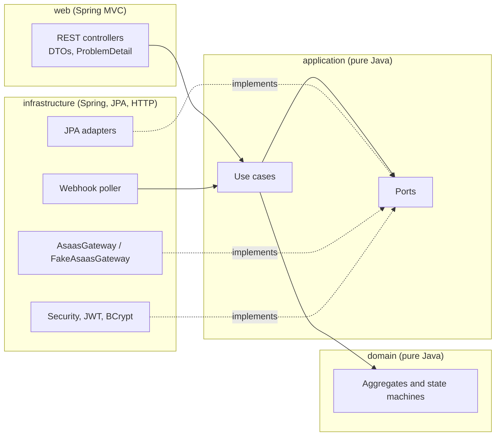

| Layer | Package | Allowed dependencies |
|---|---|---|
| domain | `com.tenantpay.billing.domain` | `java.*` only |
| application | `com.tenantpay.billing.application` | domain, `java.*` (no Spring) |
| infrastructure | `com.tenantpay.billing.infrastructure` | application, domain, Spring, JPA |
| web | `com.tenantpay.billing.web` | application, domain, Spring MVC (never infrastructure) |

### Subscribe, charge, webhook, activation

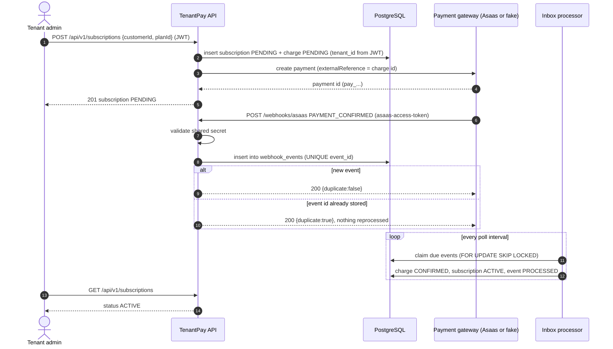

### Data model

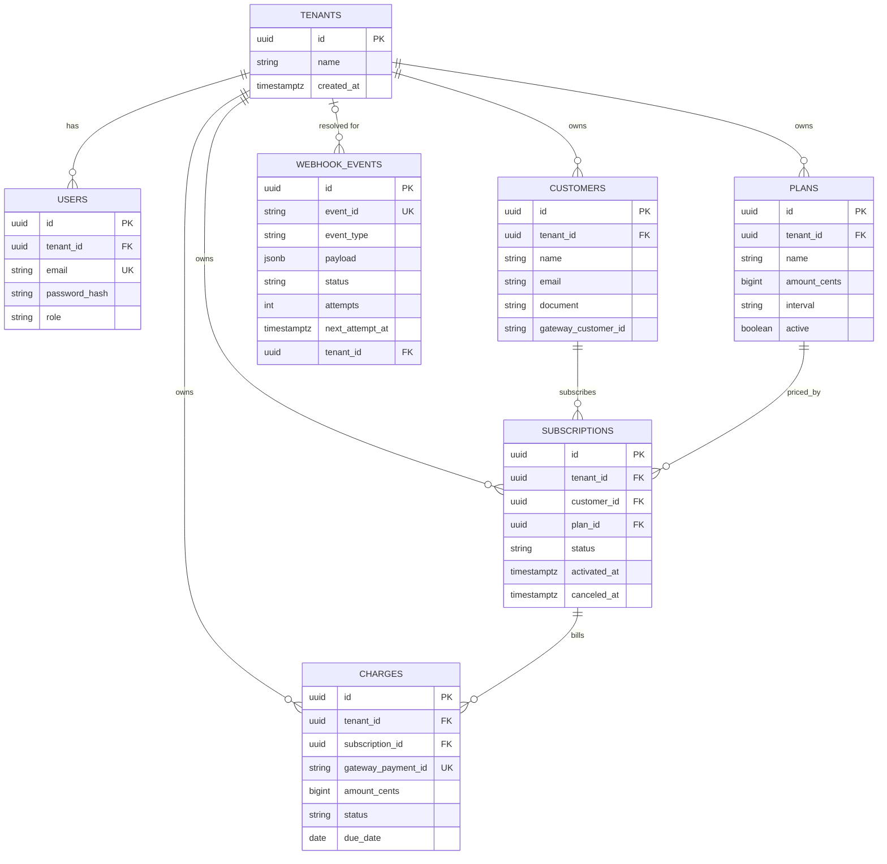

### Webhook inbox state machine

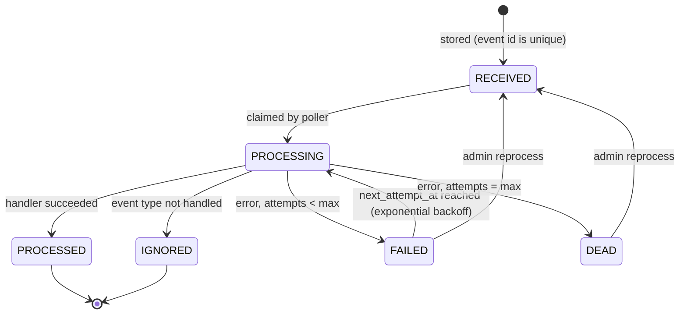

Backoff for attempt `n` is `base * 2^(n-1)`, capped at `max-backoff` (defaults: base `2s`, cap `5m`, `5` attempts).

## Key design decisions

Short ADR-style notes. Each one states the context, the decision and its trade-off.

### ADR 1: Idempotent webhooks keyed by the provider event id
- **Context**: payment providers deliver webhooks at least once; retries and duplicates are normal.
- **Decision**: every event is stored in `webhook_events` with a `UNIQUE (event_id)` constraint. A duplicate delivery returns `200` with `"duplicate": true` and is never reprocessed. The insert path also catches the unique violation, so two concurrent deliveries of the same event cannot both win. Handlers are idempotent too (activating an active subscription is a no-op), which covers different event ids describing the same state change.
- **Trade-off**: the inbox table grows forever; a retention job is on the roadmap.

### ADR 2: Inbox pattern with asynchronous processing
- **Context**: the provider expects a fast `2xx`; processing touches several aggregates and may fail transiently.
- **Decision**: the webhook endpoint only validates, stores and acknowledges. A scheduled processor claims due events with `SELECT ... FOR UPDATE SKIP LOCKED`, so several API instances can run it safely, and processes each event in its own transaction. Failures move the event to `FAILED` with exponential backoff and, after the last attempt, to `DEAD`. Admins can list and reprocess failed events.
- **Trade-off**: activation is eventually consistent (sub-second with the default poll interval) instead of synchronous.

### ADR 3: Tenant isolation in the application layer
- **Context**: a shared schema with a `tenant_id` column is the simplest multi-tenant model to operate, but a missing filter leaks data.
- **Decision**: the tenant id comes only from the signed JWT claim `tenant_id`. Every repository port method that reads tenant data takes the tenant id as an explicit argument, so forgetting it is a compile error, not a runtime leak. Resources from another tenant answer `404` (not `403`) to avoid confirming that they exist. Integration tests cover reads, lists and cross-tenant references.
- **Trade-off**: no database-level enforcement yet; PostgreSQL row-level security is on the roadmap as defense in depth.

### ADR 4: Payment gateway behind a port
- **Context**: the billing core must not depend on one provider, and the project must run without credentials.
- **Decision**: the application layer defines `PaymentGateway`. `FakeAsaasGateway` is the default and returns deterministic ids derived from the input. `AsaasGateway` talks to the Asaas v3 REST API and is enabled only when `ASAAS_API_KEY` is set. Webhook payloads use the Asaas format in both modes.
- **Trade-off**: the fake cannot reproduce every provider behavior; the real adapter is covered by HTTP-level tests with `MockRestServiceServer`.

### ADR 5: Pure Java domain and application layers
- **Decision**: domain and application have no Spring or JPA imports. Transactions are expressed through a `UnitOfWork` port implemented with `TransactionTemplate`. ArchUnit enforces it.
- **Trade-off**: some mapping code between JPA entities and domain objects, in exchange for fast unit tests and a framework independent core.

## Getting started

### Prerequisites

- Docker with Compose v2 (for the full stack and for Testcontainers)
- Java 21 (only for running the API or tests outside Docker)
- Node.js 24 (only for the panel dev server and the e2e suite)

### Run everything with Docker Compose

```bash
docker compose -p tenantpay up -d --build --wait
```

| Service | URL |
|---|---|
| Vue panel | http://localhost:15173 |
| API | http://localhost:18080 |
| Swagger UI | http://localhost:18080/swagger-ui.html |
| Health | http://localhost:18080/actuator/health |
| PostgreSQL | `localhost:55432` (db, user and password: `tenantpay`) |

Host ports are intentionally non-default to avoid clashing with other local services. Stop with `docker compose -p tenantpay down -v`.

### Run the API locally

Start only PostgreSQL in Docker and run the API on port 18080, the port the Vite dev proxy targets:

```bash
docker compose -p tenantpay up -d postgres
./mvnw spring-boot:run -Dspring-boot.run.arguments="--server.port=18080 --tenantpay.dev-tools.enabled=true"
```

In another terminal, start the panel with hot reload at http://localhost:5173 (it proxies `/api`, `/webhooks` and `/actuator` to the API):

```bash
cd frontend && npm install && npm run dev
```

### Configuration

| Variable | Default | Purpose |
|---|---|---|
| `SPRING_DATASOURCE_URL` | `jdbc:postgresql://localhost:55432/tenantpay` | Database |
| `TENANTPAY_JWT_SECRET` | dev-only value | HS256 signing key (32+ bytes, set it in any shared environment) |
| `TENANTPAY_JWT_TTL` | `PT1H` | Access token lifetime |
| `TENANTPAY_ASAAS_WEBHOOK_TOKEN` | `dev-webhook-token` | Shared secret expected in the `asaas-access-token` header |
| `ASAAS_API_KEY` | empty | When set, switches to the real `AsaasGateway` |
| `ASAAS_BASE_URL` | `https://api-sandbox.asaas.com/v3` | Asaas API base URL |
| `TENANTPAY_DEV_TOOLS_ENABLED` | `false` (`true` in compose) | Enables the "simulate payment" endpoint used by the panel |

### Switching from the fake gateway to the Asaas sandbox

1. Create a sandbox account and an API key in the Asaas sandbox dashboard.
2. Export the key (and keep it out of version control): `export ASAAS_API_KEY='$aact_...'`, or put it in a local `.env` file (see `.env.example`).
3. Restart the API. With a non-blank key the `AsaasGateway` bean replaces `FakeAsaasGateway`; customers and payments are created at `https://api-sandbox.asaas.com/v3`.
4. In the Asaas webhook settings, point the payments webhook to `https://<your-host>/webhooks/asaas` and set its auth token to the value of `TENANTPAY_ASAAS_WEBHOOK_TOKEN`.

### Tests

```bash
./mvnw verify            # unit + ArchUnit (Surefire) and Testcontainers integration tests (Failsafe) + JaCoCo
```

The JaCoCo HTML report is written to `target/site/jacoco/index.html`.

On Windows without a local JDK 21 you can run the build in a container, mounting the Docker socket for Testcontainers:

```bash
docker run --rm -v /var/run/docker.sock:/var/run/docker.sock -v "$PWD":/src -w /src \
  maven:3.9-eclipse-temurin-21 ./mvnw -B verify
```

### End-to-end tests

```bash
docker compose -p tenantpay up -d --build --wait
cd e2e
npm ci
npx playwright install chromium
npx playwright test
```

The suite signs up a tenant, logs in, creates a plan, subscribes a customer, sends a `PAYMENT_CONFIRMED` webhook twice to prove idempotency and checks that the panel shows `ACTIVE`. Each step saves a screenshot in `docs/screenshots/`.

## API examples

```bash
API=http://localhost:18080

# 1. Sign up a tenant (returns a JWT)
TOKEN=$(curl -s -X POST $API/api/v1/auth/signup -H 'Content-Type: application/json' \
  -d '{"tenantName":"Acme Gym","email":"owner@acme.test","password":"s3cret-pass"}' | jq -r .accessToken)

# 2. Log in again later
curl -s -X POST $API/api/v1/auth/login -H 'Content-Type: application/json' \
  -d '{"email":"owner@acme.test","password":"s3cret-pass"}'

# 3. Create a plan (amounts are in cents)
PLAN=$(curl -s -X POST $API/api/v1/plans -H "Authorization: Bearer $TOKEN" -H 'Content-Type: application/json' \
  -d '{"name":"Pro","description":"Pro plan","amountCents":4990,"interval":"MONTHLY"}' | jq -r .id)

# 4. Create a customer
CUSTOMER=$(curl -s -X POST $API/api/v1/customers -H "Authorization: Bearer $TOKEN" -H 'Content-Type: application/json' \
  -d '{"name":"Jane Doe","email":"jane@example.test","document":"24971563792"}' | jq -r .id)

# 5. Subscribe (status PENDING, first charge created in the gateway)
SUB=$(curl -s -X POST $API/api/v1/subscriptions -H "Authorization: Bearer $TOKEN" -H 'Content-Type: application/json' \
  -d "{\"customerId\":\"$CUSTOMER\",\"planId\":\"$PLAN\"}")
PAYMENT=$(echo "$SUB" | jq -r .latestCharge.gatewayPaymentId)

# 6. Deliver an Asaas PAYMENT_CONFIRMED webhook (send it twice: the second answer has "duplicate": true)
curl -s -X POST $API/webhooks/asaas -H 'asaas-access-token: dev-webhook-token' -H 'Content-Type: application/json' \
  -d "{\"id\":\"evt_demo_1\",\"event\":\"PAYMENT_CONFIRMED\",\"payment\":{\"object\":\"payment\",\"id\":\"$PAYMENT\",\"value\":49.90,\"status\":\"CONFIRMED\"}}"

# 7. The subscription is now ACTIVE
curl -s $API/api/v1/subscriptions -H "Authorization: Bearer $TOKEN" | jq '.[0].status'

# 8. Inspect and reprocess failed webhook events (admin)
curl -s "$API/api/v1/admin/webhook-events?status=DEAD" -H "Authorization: Bearer $TOKEN"
curl -s -X POST $API/api/v1/admin/webhook-events/<id>/reprocess -H "Authorization: Bearer $TOKEN"
```

Errors use RFC 7807:

```json
{
  "type": "about:blank",
  "title": "Bad Request",
  "status": 400,
  "detail": "Validation failed",
  "instance": "/api/v1/plans",
  "errors": [{ "field": "amountCents", "message": "must be greater than or equal to 100" }]
}
```

The full contract lives in [docs/api-contract.md](docs/api-contract.md) and in Swagger UI.

## Screenshots

Captured automatically by the Playwright suite.

| Step | Screenshot |
|---|---|
| 1. Tenant signup | 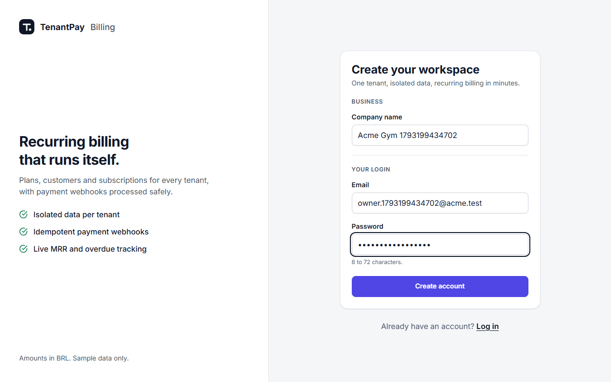 |
| 2. Login | 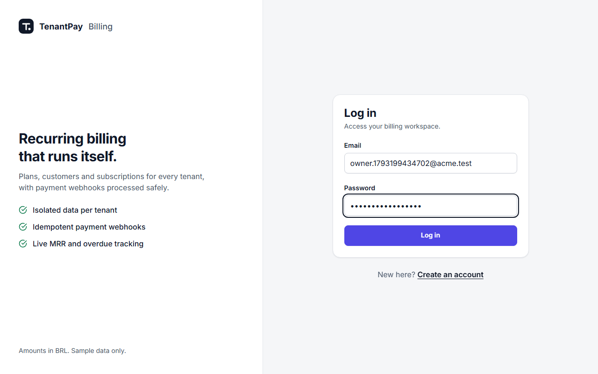 |
| 3. Plan created | 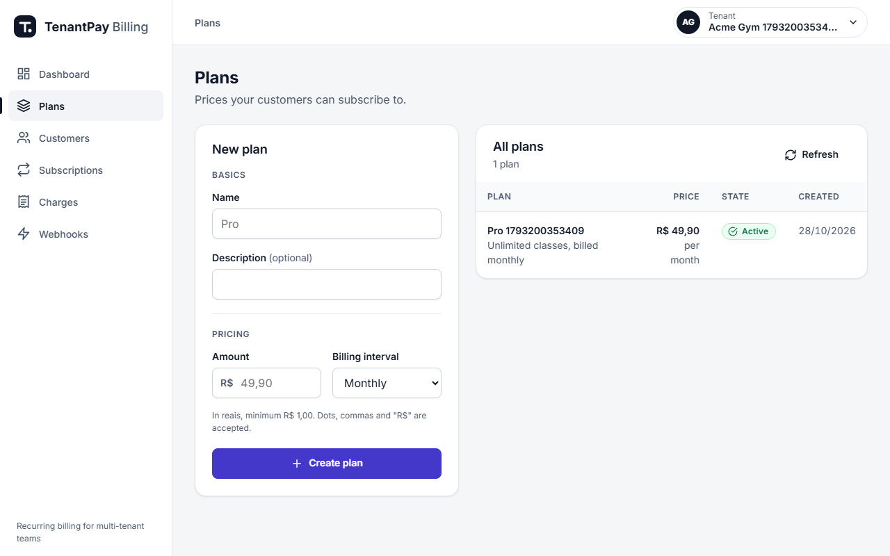 |
| 4. Subscription pending | 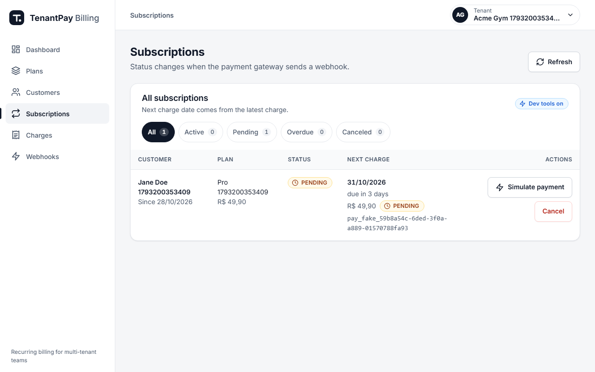 |
| 5. Webhook delivered twice (idempotent) | 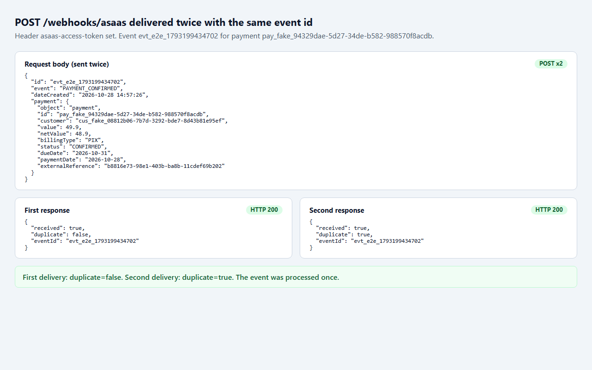 |
| 6. Subscription active | 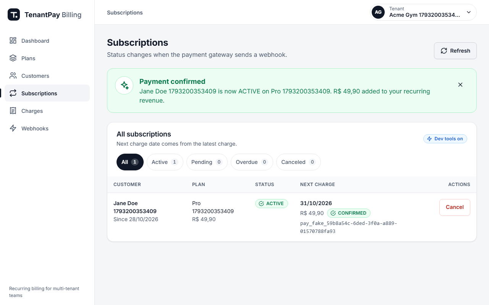 |
| 7. Dashboard | 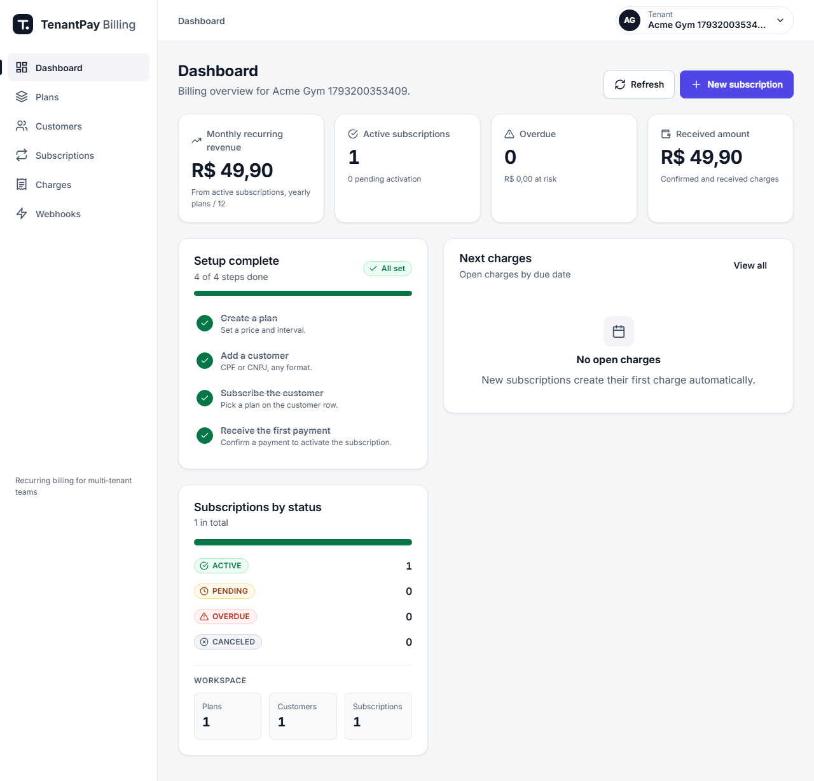 |
| 8. Simulate payment button (dev only) | 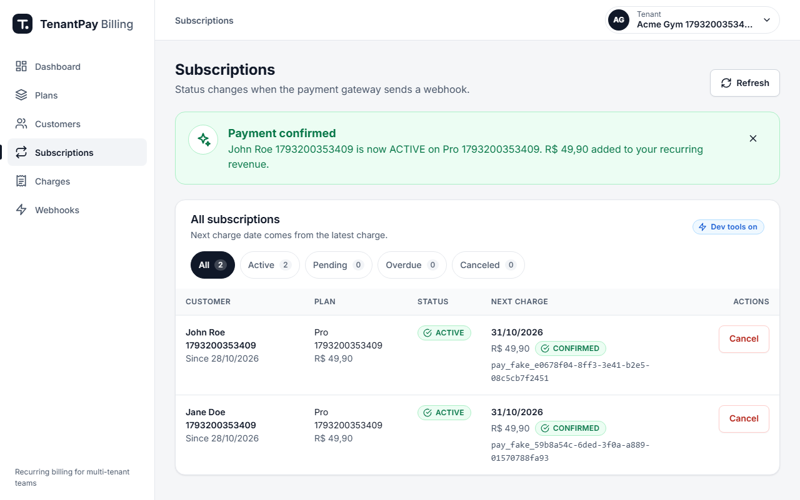 |

## Project layout

```
.
├── src/main/java/com/tenantpay/billing
│   ├── domain/            # aggregates, state machines, retry policy (pure Java)
│   ├── application/       # use cases and ports (pure Java)
│   ├── infrastructure/    # JPA, security, gateways, scheduling, wiring
│   └── web/               # REST controllers, DTOs, error handling
├── src/main/resources/db/migration   # Flyway
├── src/test/java          # unit, ArchUnit (*Test) and Testcontainers (*IT)
├── frontend/              # Vue 3 + Vite + TypeScript panel
├── e2e/                   # Playwright suite
├── docs/                  # API contract and screenshots
├── Dockerfile             # API image (multi-stage)
└── docker-compose.yml     # postgres + api + frontend
```

## Roadmap

- Recurring billing cycles: generate the next charge per plan interval with a scheduler.
- Refresh tokens and per-user roles beyond the tenant admin.
- PostgreSQL row-level security as a second tenant isolation layer.
- Transactional outbox for domain events (subscription activated, charge overdue).
- Webhook inbox retention and metrics (Micrometer counters for processed, failed and dead events).
- Asaas webhook signature hardening and IP allow-listing.
- Dunning: automatic retries and notifications for overdue charges.

## Acknowledgements

This project was inspired by the design ideas of these open source projects. No code was copied from them.

- [Kill Bill](https://github.com/killbill/killbill) (Apache-2.0): the reference open source subscription billing and payments platform.
- [sureshkvn/subscriptions](https://github.com/sureshkvn/subscriptions) (MIT)
- [samuel-ibits/AiBillingKit](https://github.com/samuel-ibits/AiBillingKit) (MIT)

## License

[MIT](LICENSE) © 2026 Joao Pedro Rocha
